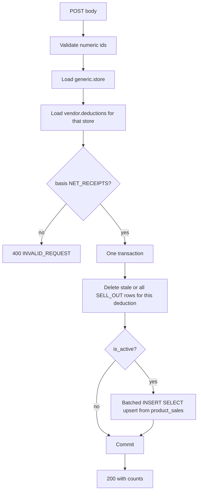

# Process Deduction API — Implementation Plan

`POST /api/vendors/deductions` replaces one deduction’s `SELL_OUT` expense rows from `vendor.product_sales` for that deduction’s effective date range, then returns how many rows were removed, created, and updated. Behavior follows [aggregator-job/REQUIREMENTS.md](REQUIREMENTS.md). The same contract is also available at `GET /api/docs` once that page exists.

The handler hooks the existing stub [`POST /deductions`](src/routes/vendors.routes.ts) in [aggregator-job/src/routes/vendors.routes.ts](src/routes/vendors.routes.ts), mounted at `/api` in [aggregator-job/src/routes/index.ts](src/routes/index.ts). Schema is [database/flyway/V1__initial_version.sql](../database/flyway/V1__initial_version.sql) plus [database/flyway/V1.3__add_deduction_id.sql](../database/flyway/V1.3__add_deduction_id.sql).

Data access for this endpoint is Drizzle ORM (`drizzle-orm` with `drizzle-orm/node-postgres`) on a `pg` `Pool` built from the env already read in [aggregator-job/src/config/database.ts](src/config/database.ts). Flyway stays the schema owner. Do not add Drizzle Kit migrations. Declare tables with `pgSchema('generic')` and `pgSchema('vendor')` so generated SQL is schema-qualified. `deduction_basis_enum` was created in `public`; declare it with `pgEnum`, not `vendor.enum`. Use `bigint(..., { mode: 'bigint' })`. The deduction service does not use the current Sequelize client.

## Flow



## Assumptions resolved from schema and seed

- `store_id` and `deduction_id` are `BIGINT`. The JSON example uses strings, so accept digit strings and reject anything else as `400` `INVALID_REQUEST` (`Invalid storeId` / `Invalid deductionId`).
- `deduction_value` is a rate, not a percent. Seed inserts `0`–`0.10`, and scenario 1 is `shipped_revenue * 0.10`. Do not divide by 100.
- Cost source column is `vendor.product_sales.shipped_revenue`.
- One expense row per sale row. Sale grain is `(product_id, store_id, report_date)`.
- Map into `vendor.expense_events` using the existing primary key: `store_id`, `product.source_system_id`, `report_date` as `expense_date`, `expense_type = 'SELL_OUT'`, `expense_subtype = deduction_type`. Also set `product_sku`, `vendor_code`, `deduction_id`, `expense_status = 'CONFIRMED'` (schema requires status; seed uses this value), `cost = ROUND(shipped_revenue * deduction_value, 2)`.
- A deduction must belong to the requested store. Wrong store returns `404` `Deduction not found`.
- `FIXED_AMOUNT` returns `400` before any write. SELL_IN is never read or written.

## Response

Keep the documented success message, including the spelling in the spec, and add the counts scenario 2 and acceptance criterion 4 require:

- `status`: `"success"`
- `message`: `"Deductions processed succesfully"`
- `expenseEventsRemoved`: rows deleted
- `expenseEventsCreated`: rows inserted
- `expenseEventsUpdated`: rows whose cost was refreshed

## 1. Database reads

Point lookups only. Sale rows are not loaded as objects; the insert-select in section 2 is the sales read.

```ts
const [store] = await db
  .select({ storeId: stores.storeId })
  .from(stores)
  .where(eq(stores.storeId, storeId))
  .limit(1);

const [deduction] = await db
  .select({
    deductionId: deductions.deductionId,
    storeId: deductions.storeId,
    deductionType: deductions.deductionType,
    deductionBasis: deductions.deductionBasis,
    deductionValue: deductions.deductionValue,
    vendorCode: deductions.vendorCode,
    effectiveDateFrom: deductions.effectiveDateFrom,
    effectiveDateTo: deductions.effectiveDateTo,
    isActive: deductions.isActive,
  })
  .from(deductions)
  .where(
    and(
      eq(deductions.deductionId, deductionId),
      eq(deductions.storeId, storeId),
    ),
  )
  .limit(1);
```

SQL Drizzle generates:

```sql
SELECT store_id FROM generic.store WHERE store_id = $1 LIMIT 1;

SELECT deduction_id, store_id, deduction_type, deduction_basis,
       deduction_value, vendor_code, effective_date_from,
       effective_date_to, is_active
FROM vendor.deductions
WHERE deduction_id = $1 AND store_id = $2
LIMIT 1;
```

`store_id` is unique even though the primary key is the marketplace composite. Deduction ownership is in the `WHERE`, so a deduction for another store is the same as missing.

Indexes used:

- `generic.store` unique `store_id`
- `vendor.deductions` primary key `deduction_id`
- `vendor.product_sales` is a hypertable on `report_date`, so the date predicate excludes chunks. [database/flyway/V1.2__add_vendor_indexes.sql](../database/flyway/V1.2__add_vendor_indexes.sql) only indexes `store_id`.
- Deletes use `storeId_deductionId` on `(store_id, deduction_id)` from V1.3.

## 2. Database writes

One `db.transaction`. A thrown error or dropped connection rolls it back. First statement inside the transaction: `SET LOCAL statement_timeout = '120s'`. Retrying the same request is safe because the operation replaces this deduction’s `SELL_OUT` rows.

Declare `expenseEvents` with the real primary key so `onConflictDoUpdate` targets it:

```ts
primaryKey({
  columns: [
    table.storeId,
    table.sourceSystemId,
    table.expenseDate,
    table.expenseType,
    table.expenseSubtype,
  ],
})
```

Delete stale rows first, including the inactive path (rule 3) and a shrunk date range (rule 5). Drizzle `notExists` / `or` / `and`. `result.rowCount` is `expenseEventsRemoved`. If `isActive` is false, commit after the delete.

```ts
await tx.delete(expenseEvents).where(
  and(
    eq(expenseEvents.storeId, storeId),
    eq(expenseEvents.deductionId, deductionId),
    eq(expenseEvents.expenseType, "SELL_OUT"),
    or(
      sql`${isActive} = false`,
      lt(expenseEvents.expenseDate, from),
      gt(expenseEvents.expenseDate, to),
      notExists(
        tx
          .select({ one: sql`1` })
          .from(productSales)
          .innerJoin(products, eq(products.productId, productSales.productId))
          .where(
            and(
              eq(productSales.storeId, expenseEvents.storeId),
              eq(productSales.reportDate, expenseEvents.expenseDate),
              eq(products.sourceSystemId, expenseEvents.sourceSystemId),
              gte(productSales.reportDate, from),
              lte(productSales.reportDate, to),
            ),
          ),
      ),
    ),
  ),
);
```

Upsert only when the deduction is active and `NET_RECEIPTS`. Each batch stays in the same transaction:

1. Select the next 5,000 keys only: `productId`, `reportDate`, ordered by those columns, keyset `(reportDate, productId) > cursor`. This is the only sale payload in Node, and it is two columns.
2. `tx.insert(expenseEvents).select(...)` for those pairs. Join `productSales` to `products` and `deductions`. Cost is `sql` ``ROUND(${productSales.shippedRevenue} * ${deductions.deductionValue}, 2)``. `onConflictDoUpdate` sets `cost`, `productSku`, `vendorCode`, `deductionId`, and `updatedAt` from `excluded`, and leaves `created_at` alone.
3. `.returning({ inserted: sql`(xmax = 0)` })` yields 5,000 booleans, not full events. Sum inserts vs updates in JS. The last key is the next cursor.
4. Stop when the key query returns fewer than 5,000 rows.

```ts
const written = await tx
  .insert(expenseEvents)
  .select(salesSelect)
  .onConflictDoUpdate({
    target: [
      expenseEvents.storeId,
      expenseEvents.sourceSystemId,
      expenseEvents.expenseDate,
      expenseEvents.expenseType,
      expenseEvents.expenseSubtype,
    ],
    set: {
      cost: sql`excluded.cost`,
      productSku: sql`excluded.product_sku`,
      vendorCode: sql`excluded.vendor_code`,
      deductionId: sql`excluded.deduction_id`,
      updatedAt: sql`NOW()`,
    },
  })
  .returning({ inserted: sql<boolean>`(xmax = 0)` });
```

Generated shape:

```sql
INSERT INTO vendor.expense_events (...)
SELECT ...
FROM vendor.product_sales
JOIN generic.product ON ...
JOIN vendor.deductions ON ...
WHERE store_id = $1
  AND report_date >= $2 AND report_date <= $3
  AND (report_date, product_id) IN (...)
ON CONFLICT (store_id, source_system_id, expense_date, expense_type, expense_subtype)
DO UPDATE SET cost = excluded.cost, product_sku = excluded.product_sku,
              vendor_code = excluded.vendor_code, deduction_id = excluded.deduction_id,
              updated_at = NOW()
RETURNING (xmax = 0);
```

Known limitation: the primary key does not include `deduction_id`. Two active `NET_RECEIPTS` deductions with the same `deduction_type`, product, and day will collide, and the later upsert would take the row. This endpoint cannot fix that without a migration. Document it; do not change the key in this scope.

## 3. Performance for 100,000+ sales

- App memory stays bounded to one 5,000-key page plus insert/update counts. No full sale or expense objects. No Sequelize `findAll`.
- Postgres still does the work: Drizzle `insert().select()` is `INSERT … SELECT`. Timescale drops chunks outside the effective range.
- Batch size 5,000 bounds each statement’s lock and WAL while the surrounding transaction still rolls back as a unit.
- Do not log sale rows. Log store id, deduction id, basis, active flag, date range, batch number, removed/created/updated, and duration.
- Statement timeout on the transaction (for example 120s) so a stuck scan fails as `500` `PROCESSING_FAILED` and rolls back, which the client can retry.

## 4. Future considerations

- Migration: `CREATE INDEX ON vendor.product_sales (store_id, report_date, product_id)` so the store-plus-range scan does not rely on the `store_id`-only index plus chunk exclusion.
- Migration: extend the `expense_events` primary key with `deduction_id` (partition column `expense_date` stays in the key) so two fees on the same product-day can coexist.
- If `effective_date_to` is a calendar date, compare with an inclusive end-of-day in UTC. Today both columns are `timestamptz`, so compare the stored instants.
- `FIXED_AMOUNT` and SELL_IN stay out of this endpoint. A later endpoint would use purchase orders, not `product_sales`.
- Align the current validation and error middleware with the spec envelope (`status`, `error`, `message`). Today [validateRequest.ts](src/middleware/validateRequest.ts) returns `Validation Error` plus `details`, and [errorHandler.ts](src/middleware/errorHandler.ts) returns `error` plus an optional stack.

## Error map

- `400` `INVALID_REQUEST`: missing or non-numeric ids, or basis is not `NET_RECEIPTS`
- `404` `NOT_FOUND`: `"Store not found"` or `"Deduction not found"`
- `500` `PROCESSING_FAILED`: `"Failed to process deduction: <details>"` after rollback
